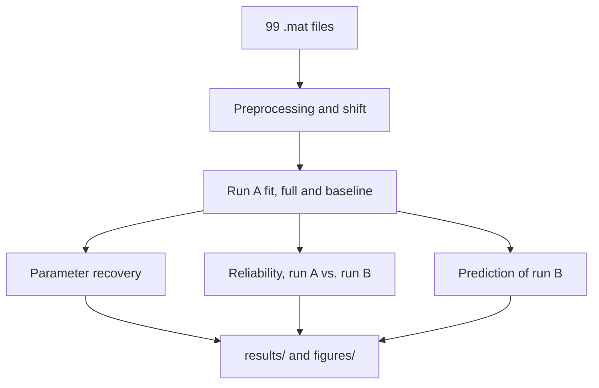

# Choice and Reaction Time in Delay Discounting

A joint model of choices and reaction times (RT) in a delay discounting task, fitted per participant and evaluated on parameter recovery, test-retest reliability and out-of-sample prediction.

## At a glance

- **What:** I modelled choice and RT in a delay discounting task and tested whether adding RT improves on a model that uses choices alone.
- **My role:** this was a three-person group project for the course Computational Cognitive Science (Summer Term 2026). I built the shared pipeline (data loading, preprocessing, valuation and choice model, fitting, and the recovery, reliability and prediction framework), the choice-only baseline and the absolute-conflict model. The original project compared three RT models. This repository contains only my part.
- **Scale:** 99 participants with two runs each (run A and run B), 28,475 trials after cleaning (28,990 before).
- **Model:** hyperbolic valuation of each option, a softmax choice rule on the value difference ΔV, and a shifted log-normal RT distribution whose location falls linearly with |ΔV| (the absolute-conflict model, μ = a − b·|ΔV|).
- **Estimation:** per-participant maximum a posteriori (MAP) estimation with L-BFGS-B, keeping the best of a 6-candidate multi-start pool (1 heuristic start plus 5 random starts) in every fit.
- **Evaluation:** parameter recovery on simulated data, test-retest reliability between run A and run B, out-of-sample prediction of run B from run-A parameters, and a comparison with a choice-only baseline.
- **Main results:**
  - Recovery is good for the discount rate k, the choice sensitivity β, the RT baseline a and the RT noise σ (Pearson r from 0.898 to 0.966) and weaker for the conflict slope b (r = 0.758), because the conflict effect is small (its median size is 0.26% of a).
  - Test-retest reliability is low. For k, r = 0.091 in the full model and r = 0.248 in the baseline.
  - Adding RT did not improve choice prediction on run B. Pooled choice log-likelihood per trial (higher is better) was −1.679 for the full model and −1.481 for the baseline, and accuracy was 0.681 and 0.686. Subject by subject, the baseline is better for 54 and the full model for 45 of the 99 participants.
- **Tools:** Python 3.12, NumPy, SciPy, pandas, Matplotlib, Jupyter, LaTeX.

| Path | Contents |
|---|---|
| [absolute_conflict_rt_model.ipynb](absolute_conflict_rt_model.ipynb) | The full analysis, with saved outputs |
| [report/absolute_conflict_rt_report.pdf](report/absolute_conflict_rt_report.pdf) | Standalone 4-page report (LaTeX source alongside) |
| [results/](results/) | Six result tables written by the notebook |
| [figures/](figures/) | Four parameter-recovery figures written by the notebook |

## How it works



**Preprocessing**, per participant and run, in order: drop trials with a missing value in any column, drop missing choices, drop RT below 200 ms, and drop RT above Q3 + 3 × IQR.

**Model.** Each option's subjective value is V = A / (1 + kD), with D = 0 for the immediate option. Choice follows P(delayed) = sigmoid(β·ΔV), with ΔV = V(delayed) − V(immediate). RT follows log(RT − shift) ~ Normal(μ, σ) with μ = a − b·|ΔV|, so responses are slower when the two options are close in value. The full model has five parameters (k, β, a, b, σ), and the baseline has two (k, β).

### Design decisions

- **Shift.** Each participant gets one shift, 0.8 × the minimum cleaned RT of both runs pooled. The pooled minimum is no larger than either run's own minimum, so RT − shift stays positive in every trial of both runs, also when run B is fitted on its own.
- **Multi-start.** With a single heuristic start, one participant's b stayed at a local optimum on its lower bound. Every fit therefore keeps the best of 6 candidates: the heuristic start plus 5 random starts drawn uniformly within the bounds (a has no bound and is drawn from its prior). The heuristic solution is always in the pool, so the final fit is never worse than a single-start fit. Seeds are fixed for reproducibility.
- **Weak priors.** Half-normal priors on k (scale 1), β (scale 5), b (scale 2) and σ (scale 1), and a normal prior on a centred on the log median RT of the data being fitted (sd 2), together with bounds, keep the optimiser from diverging.
- **Baseline is fitted separately.** The choice-only baseline uses the same valuation and choice rule but fits k and β from the choice likelihood alone. Both parameters are fitted independently in the baseline and in the full model, which makes the two directly comparable and isolates the effect of adding RT.
- **Independent run B.** Run B is fitted with the same pipeline and a different random seed and shares no information with run A.
- **Pooled prediction metrics.** Predictive log-likelihood and accuracy are computed over all 19,681 run-B trials pooled across participants, so participants with more trials count proportionally more. Next to the pooled numbers, the report gives the subject-by-subject count and shows that two participants account for 99.0% of the summed difference in choice log-likelihood.

## Reproducing the results

**Data.** The data are not included. They were provided by the course without any stated terms for redistribution, so they are not shipped with this repository. Place the 99 per-participant `.mat` files (`Sample1_<id>.mat` for 49 participants, `Sample2_<id>.mat` for 50) directly in `DD_data/` at the repository root. Each file contains `data_train` (run A), `data_test` (run B) and `data_labels`. Both data matrices have one row per trial and these 7 columns:

| # | Label | Meaning |
|---|---|---|
| 1 | `immOutcome` | Immediate reward amount |
| 2 | `delOutcome` | Delayed reward amount |
| 3 | `delay` | Delay in days |
| 4 | `action` | Choice: 1 = immediate, 2 = delayed, 0 = missing |
| 5 | `p_imm` | Experimental condition parameter |
| 6 | `condition` | 1 = reward, 2 = loss (only 1 occurs in this data set) |
| 7 | `RT` | Reaction time in ms |

**Install and run** with Python 3.12, from the repository root:

```bash
python3 -m venv .venv
.venv/bin/pip install -r requirements.txt jupyter nbconvert
.venv/bin/jupyter nbconvert --to notebook --execute --inplace \
    --ExecutePreprocessor.timeout=-1 absolute_conflict_rt_model.ipynb
```

A full run takes about 20 to 30 minutes, depending on the machine. It refills the notebook outputs and rewrites the four figures in `figures/` and the six tables in `results/`, where `<model>` is `absolute_conflict` or `baseline`:

- `recovery_long_<model>.csv`: true and recovered parameters per participant
- `reliability_long_<model>.csv`: run A vs. run B Pearson r and ICC(2,1) per parameter
- `predictive_long_<model>.csv`: run-B choice and RT predictive metrics per participant

In one test run with the package versions in `requirements.txt`, the rewritten tables matched the ones in this repository byte for byte.

## License

MIT, see `LICENSE`.
